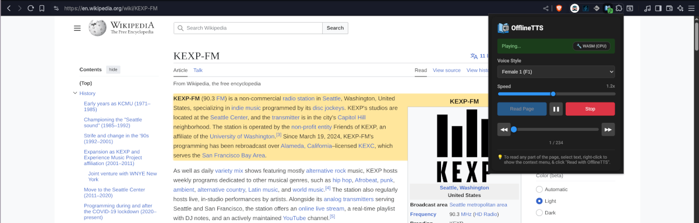
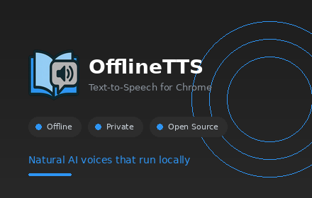

# OfflineTTS - Browser Extension
maintained by: @hkdb

A Chrome extension that reads web pages and PDFs aloud using [Supertonic](https://github.com/supertone-inc/supertonic)'s high-quality neural TTS voices - completely open source, offline and private.

## 🚀 Features

- **4 Natural Voices** - Male 1, Male 2, Female 1, Female 2  
- **Read Web Pages** - Extract and read article text  
- **Read Selected Text** - Right-click context menu  
- **Speed Control** - Adjust playback speed (0.5x - 2.0x)
- **Pause & Resume** - Pause anywhere and continue to listen later
- **Offline TTS** - Runs locally using ONNX Runtime Web  
- **PDF Support** - Reads PDF documents
- **Keyboard Shortcuts** - Alt+P (play/pause), Alt+O (stop), Alt+. (skip forward), Alt+, (skip back)

## ⏳ Current Status

v0.01.0 feature complete with some outstanding improvements pending. WebGPU support is work-in-progress but supertonic is really small enough that it does pretty well with CPUs already.

## 🏖️ Screenshot

## 📦 Installation

Install it via the Chrome Web Store:

Or if you prefer to avoid Google entirely, you can install it locally. Instructions are [here](docs/INSTALL.md).

## 💻 Usage

**Read Full Page**

1. Click the OfflineTTS icon in toolbar
2. Select a voice (M1, M2, F1, F2)
3. Adjust speed if desired
4. Click "Read Page"

**Read Selected Text**

1. Highlight text on any web page
2. Right-click and select "Read with OfflineTTS"

**Controls**

- **Play/Pause** - Alt+P or popup button
- **Stop** - Alt+O or popup button
- **Skip Forward** - Alt+.
- **Skip Back** - Alt+,

## 🩺 Known Limitations

- **WebGPU not yet working** - Currently uses WASM backend with CPU only
- **Large in size** - The extension is large in size but that's sort of the trade off for doing everything locally.
- **English & Korean Only** - Supertonic is fairly new and so-far, it only supports English and Korean.

## 🦾 Support this Project

If you like what you see and want to show your appreciation, feel free to give this repo a star.

And of course, I also love coffee!

## 🛠️ Contributing

Contributions are welcome! See [CONTRIBUTING.md](CONTRIBUTING.md) for guidelines.

For architecture details and component documentation, see [docs/ARCHITECTURE.md](docs/ARCHITECTURE.md).

## 🏛️ License

Apache 2.0 License - See LICENSE file

## 🎬 Credits

- **Supertonic** - https://github.com/supertone-inc/supertonic
- **ONNX Runtime** - https://onnxruntime.ai/
- **PDF.js** - https://mozilla.github.io/pdf.js/
- Built with assistance from OpenCode using a combination of Claude OPUS 4.5 and Sonnet 4.5

## 📢 Disclaimer

This software is provided as is with no warranty. The author and contributors of this project are not responsible for any damages that this software may directly or indirectly cause.

This project is not affiliated with the supertonic project or Supertone Inc.
